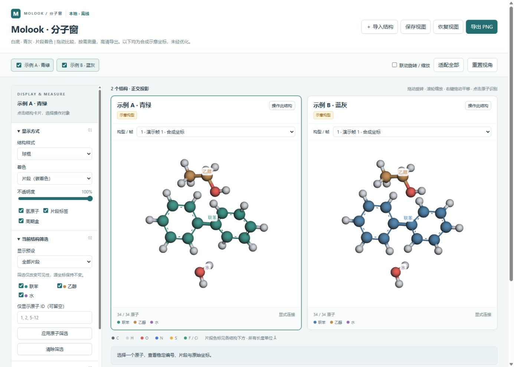

# Molook · 分子窗

[English](README.md) · [Agent 部署提示词](DEPLOY_WITH_AGENT.md) · [下载发布包](https://github.com/ljpyztd-cyber/molook/releases)

**Molook = Mol（分子）+ Look（观察）**，中文名 **分子窗**。白底青灰风格的本地离线结构工作台。支持最多四个结构对照、源原子编号查看、几何测量，以及带来源信息的高清图片导出。

**1.1.1 默认独立控制每个面板的旋转与缩放。** 只有手动勾选“联动旋转 / 缩放”后才会同步其他面板。



## 快速使用

需要 **Python 3.10+** 和启用 **WebGL** 的现代浏览器。无需安装 pip/npm 包，无需云账号或 API key，渲染依赖已完整离线打包。

下载并解压 Release 中的 ZIP，或克隆仓库：

```sh
git clone https://github.com/ljpyztd-cyber/molook.git
cd molook
python -B run.py
```

Windows 也可双击 `START_DEMO.cmd`。macOS/Linux 若命令名为 `python3`，将以上 `python` 换为 `python3`。浏览器未自动打开时，打开启动器输出的 `http://127.0.0.1:端口/`。

```sh
python -B run.py --no-open     # 启动，只输出地址
python -B run.py status        # 查看本演示实例状态
python -B run.py stop          # 停止本演示实例
python -B scripts/self_test.py # 运行自检
```

Windows 还可双击 `STOP_DEMO.cmd`。首次启动将演示构建到 `demo-project/codex-files/molook-demo-v1.1.1/`，重复启动会复用匹配实例。服务仅监听本机 **127.0.0.1**，默认空闲 120 分钟自动停止。

可用 `--project "D:/MyWork/Viewer"` 指定工作目录；启动、查询和停止均须传相同目录。生成的预览、导入、导出及日志统一位于该项目的 `codex-files/` 内。

请勿直接双击 HTML：导入、导出和视图恢复需要本地 Python 接口。本工具适合本地部署，不是 GitHub Pages 网站或公网多人服务。

## 主要功能

- 双面板/四面板结构对照，默认独立相机，可选联动旋转与缩放。
- 球棍、棍状、空间填充、细线显示；元素/片段碳着色；氢、标签、周期盒和片段筛选。
- 稳定原子 ID、距离、角度和带符号二面角；均使用源坐标。
- 明确区分几何接触候选与科学结论。
- 每面板 1,200 / 1,800 / 2,400 px 的高清 PNG 导出，内嵌来源、相机、可见原子等元数据，并生成 JSON 旁车。
- 同一数据集内保存/恢复视图；显示操作不改写源坐标。

目前界面文字为中文；README 与 agent 部署提示词提供中英文。

## 导入自己的结构

点击“＋ 导入结构”，或使用命令行新建预览：

```sh
python -B scripts/preview.py build --project "D:/MyWork/Project" --input "D:/Data/model.sdf" --title "结构对照"
python -B scripts/preview.py start --bundle "上一步输出的bundle路径" --open
python -B scripts/preview.py stop --bundle "同一个bundle路径"
```

重复 `--input` 可添加多个结构；需要片段名称、颜色或筛选预设时使用 `--dataset examples/demo.json`，详见 [数据格式](DATA_FORMAT.md)。

| 格式 | 支持范围 |
| --- | --- |
| XYZ | 单/多帧、每行元素和三坐标；简单 Extended XYZ lattice/pbc |
| SDF / MOL | V2000，显式连接和键级；不支持 V3000/query bonds |
| PDB | 显式元素列、MODEL、CRYST1、CONECT；拒绝 altloc 与部分占位 |
| CIF | 单数据块、明确 P1、完整占位；不自动展开对称性或选择无序构型 |

没有连接信息时不会猜键，因此普通 XYZ 只显示原子。归一化坐标单位为 Å，XYZ 原始单位由数据提供者确认。

## 数据边界与维护

演示全部是脚本生成的合成坐标，**未经优化，不代表研究结果**。预览器不认定计算收敛、化学正确性或科学验收；`accepted` 状态必须由提供者附证据引用。

几何测量不使用周期最小镜像。接触虚线只代表有限条件下的几何候选，不是完整氢键分析。导出时各面板独立适配，不能当成统一比例尺。

源文件、原子身份和指纹保留，显示操作不写回源结构。bundle 是不可变快照：修改代码/数据后应构建到新目录，不绕过完整性校验。不要公开 `.runtime/`、私有导入结构、私有导出图或日志。

包内只包含独立应用、文档、第三方声明及合成示例；无需安装任何 agent skill。

- [中英文 Agent 部署提示词](DEPLOY_WITH_AGENT.md)
- [接手与维护说明](AGENT_HANDOFF.md)
- [视觉风格说明](STYLE_GUIDE.md)
- [数据格式](DATA_FORMAT.md)
- [版本记录](CHANGELOG.md) / [验证范围](VALIDATION.md)

自检仅使用 Python 标准库；GitHub Actions 在 Windows/Ubuntu、Python 3.10/3.13 运行相同测试。发布脚本采用明确文件清单，排除运行数据和 Git 历史。

## 许可

应用代码及合成示例使用 [MIT](LICENSE) 许可。3Dmol.js 2.5.5 保留 BSD-3-Clause 及其依赖声明，见 [第三方声明](THIRD_PARTY_NOTICES.md)。
